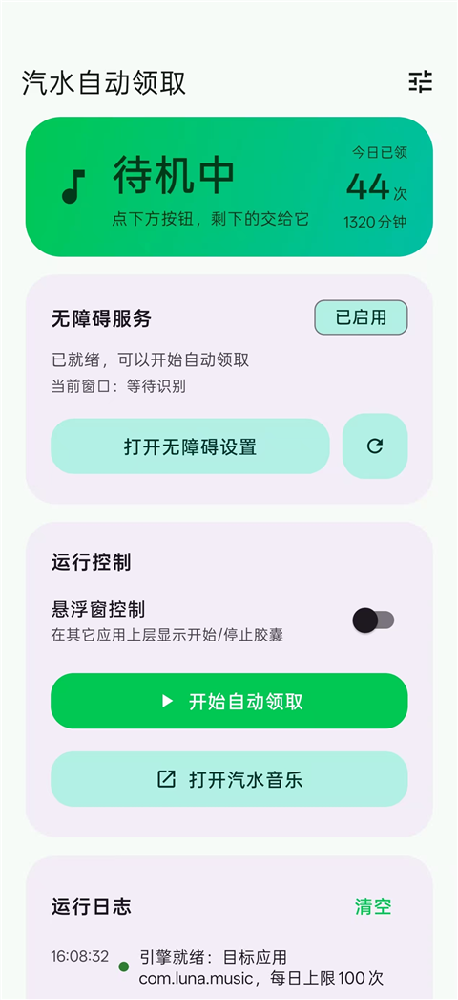
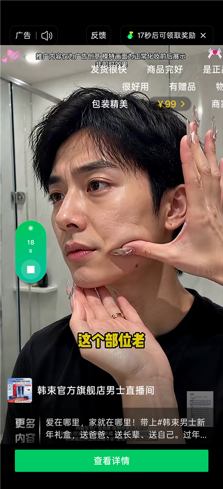

# 汽水自动领取 · SodaMusicHelper

> 汽水音乐（`com.luna.music`）自动完成「看广告 → 领取免费听时长」的 Android 无障碍小工具。
> 用户只需开无障碍 + 点开始，**不用标定、不用配置关键词、不用装插件**。

## 下载

[](https://github.com/GXSZone/SodaMusicHelper/releases/latest/download/SodaMusicHelper.apk)

- **直接下载 APK**（7.1 MB，arm64）：<https://github.com/GXSZone/SodaMusicHelper/releases/latest/download/SodaMusicHelper.apk>
- **发布页（版本说明 / 历史版本）**：<https://github.com/GXSZone/SodaMusicHelper/releases/latest>

> 装好后到系统「设置 → 无障碍」启用 **SodaMusic Helper** 服务，回 App 点「开始自动领取」即可。

## 软件界面

**首页** — 待机中、无障碍已启用、今日统计与运行日志



**看广告时的悬浮窗** — 左侧胶囊显示广告页真实倒计时（截图 18s ↔ 广告 17s）



## 特性

- **零配置**：只认包名，页面靠无障碍节点判定，不依赖分辨率坐标；
- **广告页内绝不乱点**：只读倒计时，不点「查看详情 / 立即购买 / 领取奖励 / 坚持退出」；
- **只在自家 App 里返回**：看广告期间你切到别的 App，它只等待、绝不按返回键；
- **悬浮窗实时倒计时**：竖排小胶囊，数字取自广告页的真实倒计时（截图里胶囊 18s ↔ 广告 17s）；
- **可收起的胶囊**：双击收成底部 36dp 圆点（可拖动、点按/长按恢复、位置记忆）；
- **记账防重**：一条广告只记一次，必须"真的播放过 + 完成判据成立"才 +30 分钟；
- **基于 assists 官方能力**：`stepper2` 步骤器、`AssistsWindowManager` 悬浮窗、`findById/getAllNodes` 节点能力、`saveRootNodeTreeJson` 调试导出。

## 三步开始

1. 安装 APK；
2. 首页点 **打开无障碍设置**，启用 **SodaMusic Helper 自动化服务**；
3. 回到 App 点 **开始自动领取**。

目标包名默认 `com.luna.music`，需要更换在「高级设置 → 目标应用包名」改。

## 运行机制

一轮 = **开轮 → 入口 → 看广告 → 记账复位**（stepper2 四步；每步都有退出条件，不会死循环）。

| 阶段 | 判定 | 动作 |
|---|---|---|
| 开轮 | 前台 == 目标包 且 活动窗口无广告文案 | 回主界面三步：点右上角关闭 → 显式启动 MainActivity → 最后才按 back |
| 入口 | 发现页右上角领取入口 | 四档依次试：坐标 `(0.857, 0.0787)` → `id/vu` → 区域内最小可点击节点 → 模板匹配（仅 debug） |
| 看广告 | 倒计时节点 / 「秒后可领取奖励」/ 窗口类名含 `excitingvideo` | 每 500ms 采样一次，**不点击、不滑动** |
| 完成 | 「领取成功」/ 倒计时归零 + 1s 复查 / 广告窗口连续 3 次采样消失 + 800ms 复查（三者都要求播放过） | 记 1 次（次数 + 分钟） |
| 复位 | 已记账 | 显式启动 MainActivity → 收起结算/免单弹窗 → 底部 tab 校验 → 下一轮 |
| 让行 | 非广告阶段且前台是第三方 App | 不点击、不 back、不拉起，最多等 60s |
| 直播间 | 窗口类名含 `LivePlayer`，或「说点什么」+（观众/礼物/直播间） | 点右上角「关闭」；回主界面则**本轮放弃重开（不计数）** |
| 免单弹窗 | 「再看 + 免费听」或「领取奖励/坚持退出/立即使用」≥2 | 归为奖励浮层，收起后继续，不当广告页 |

**看广告时切走手机不会被打断**：前台不是汽水 → 只记录日志并等待；切回来自动续看；太久不回则放弃本轮（不计数）。

结束条件：达到每日上限 / 连续 3 次进不去广告页（多数是汽水当天任务到顶）/ 用户停止 / 让行超时。

## 构建

```powershell
$env:JAVA_HOME = "C:\Program Files\Java\jdk-21"
.\gradlew.bat :app:assembleDebug
```

| 包 | 体积 | 说明 |
|---|---|---|
| `debug` | ~44 MB | 额外包含 assists-opcv（OpenCV 模板匹配，只作排障/兜底） |
| `release` | ~7 MB | 不含 OpenCV |

- 基线：AGP 9.5.0 / Gradle 9.8.2 / compileSdk 36 / targetSdk 36 / minSdk 24 / Java 17（`jdk-21` 编译）
- 依赖：material 1.14.0、core-ktx 1.17.0、appcompat 1.8.0、activity 1.13.0、lifecycle 2.11.0、recyclerview 1.4.0、coroutines 1.10.2、`assists-base 3.5.10`（已排除其 MLKit OCR）

## 目录结构

```
app/src/main/java/com/sodamusic/helper/
├── MainActivity.kt                首页：状态、日志、高级设置
├── automation/
│   ├── AdClaimFlow.kt             stepper2 四步编排 + 记账（247 行）
│   ├── flow/
│   │   ├── Keywords.kt            关键词 / 坐标比例 / 阈值（单一来源）
│   │   ├── WatchOutcome.kt        看广告结果（sealed interface）
│   │   ├── PageState.kt           页面判定、弹窗关闭、直播间识别
│   │   ├── WatchAd.kt             看广告采样状态机（四态判据 / 漂移 / 进度）
│   │   ├── EntryNavigation.kt     发现 tab → 入口四档 → 等广告页
│   │   └── ResetFlow.kt           开轮复位 / 回主界面
│   ├── util/FlowUtil.kt           点击与日志小工具
│   ├── NodeScanner.kt             节点采集与匹配
│   ├── NodeActions.kt             点击 / 坐标 / 拉起 / 等待
│   ├── AutomationRuntime.kt       门面：运行状态、日志（镜像 logcat）、自动恢复
│   └── AutomationModel.kt         状态与设置数据类
├── ui/
│   ├── floating/                  悬浮窗：controller / window / drag / appearance / mode
│   ├── SettingsForm.kt            高级设置弹窗映射
│   ├── ViewExtensions.kt          View.isVisible / TextView.setTextRes
│   ├── LogAdapter.kt              日志列表
│   └── PhaseTextFormatter.kt      胶囊文案（竖排紧凑）
├── settings/AppPreferences.kt     设置 + 今日统计（跨天重置）
└── accessibility/                 无障碍服务（只做注册与转发）
app/src/debug/java/…               调试广播 + OpenCV 模板定位（release 不含）
scripts/adb-flow.ps1               截图 + 日志闭环脚本
screenshots/                       README 用界面截图
```

## 调试（仅 debug 包）

```powershell
# 启停引擎
adb shell am broadcast -n com.sodamusic.helper/.DebugCommandReceiver -a com.sodamusic.helper.DEBUG_START
adb shell am broadcast -n com.sodamusic.helper/.DebugCommandReceiver -a com.sodamusic.helper.DEBUG_STOP

# 导出当前所有窗口的节点树（替代 uiautomator dump）
adb shell am broadcast -n com.sodamusic.helper/.DebugCommandReceiver -a com.sodamusic.helper.DEBUG_DUMP
adb exec-out "run-as com.sodamusic.helper cat cache/node-tree-*.json" > tree.json

# 实时日志
adb logcat -v time -s SodaAuto
```

> ⚠️ **不要用 `adb shell uiautomator dump`**：它会注册 UiAutomation，系统因此解绑我们的无障碍服务，表现为引擎"自己停了"。用上面的 `DEBUG_DUMP`。

## 常见问题

| 现象 | 原因 / 处理 |
|---|---|
| 首页显示「无障碍服务未连接」 | 重装 App 后服务需重新绑定：开关一次无障碍服务，或点「打开无障碍设置」重新勾选 |
| 入口点了没反应、日志出现「连续 3 次未进入广告页」 | 汽水当天的「看广告加时长」任务到顶（入口会静默失效），属于正常结束，次日刷新 |
| 广告页里胶囊不见 | 部分广告页会隐藏非系统悬浮窗；广告结束/回到主界面即恢复 |
| 悬浮窗在广告页显示的数字 | 就是广告页右上角的真实倒计时（500ms 采样，可能差 1s） |
| 想看完整节点结构 | 用 `DEBUG_DUMP` 导出 JSON，不需要 uiautomator |

## 边界与合规

- 只用系统无障碍能力模拟点击：**不破解、不注入、不改包、不绕过广告计费**；
- 广告页内不点击、不滑动，仅对提示页/弹窗做「关闭/继续观看」这类必要操作；
- 点击闸门只认「前台 == 目标包名」，其它应用一律只让行；
- 不做网络上报、不收集账号信息，统计只存本地 SharedPreferences；
- 依赖 `io.github.ven-coder:assists-base:3.5.10`（GPL-3.0），当前仅供个人学习与内部验证。

## 已知限制

- 汽水"看广告加时长"每天有隐藏上限，到顶后入口静默失效；
- 直播间里按返回键会退出整个汽水，因此返回逻辑以「点右上角关闭 + 显式拉起」为主，back 仅作最后手段；
- 模板匹配依赖 debug 包与 `app/src/main/assets/templates/discover_entry.png`，仅作入口兜底；
- 无障碍截图（OpenCV 取屏）需要系统 API 30+。